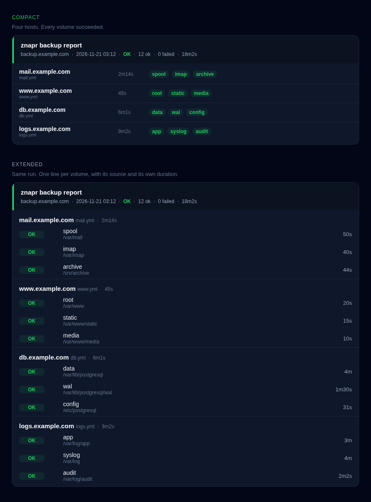
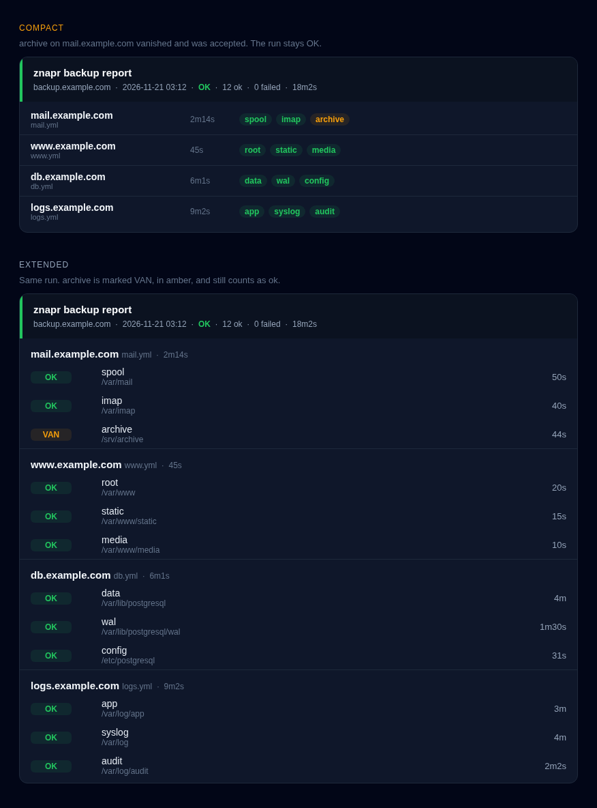
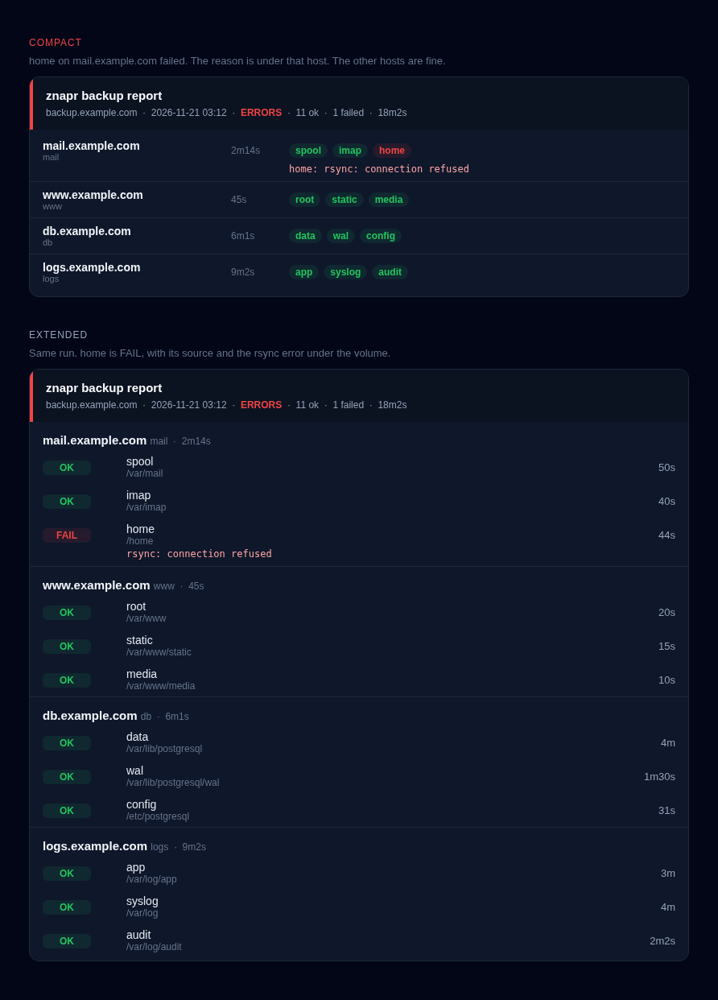
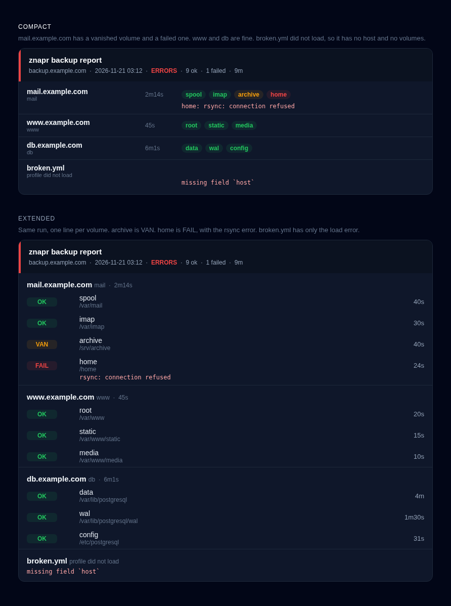

# znapr

znapr backs up remote directories onto local ZFS datasets. For each volume it rsyncs the data over SSH, then takes a snapshot whose name carries the retention period. Expired snapshots are destroyed later by `cleanup`.

A profile is one YAML file. It owns one parent dataset, `zfsroot/name`. Each volume in that file is a child dataset, `zfsroot/name/volume`.

## Requirements

- ZFS userland tools: `zfs` and `zpool`
- `rsync`
- an OpenSSH client
- Rust edition 2024, to build

A local MTA that provides `/usr/sbin/sendmail` is needed only for the mail report. Override the path with `ZNAPR_SENDMAIL`.

## Build

```sh
cargo build --release
```

The binary is `target/release/znapr`.

## Configuration

Profiles are `*.yml` files in `/etc/znapr`. Every command accepts `-c` / `--config-directory` to use another directory. Files are read in name order. The profile's identity is the `name` field, not the file name.

```yaml
name: mail
zfsroot: tank/backup
host: mail.example.com
port: 22
sshkey: /root/.ssh/backup_ed25519
volumes:
  spool:
    source: /var/mail
    max-days: 30
    excludes:
      - "*.tmp"
  archive:
    source: /srv/archive
    max-days: 90
```

| Field | Where | Meaning |
| --- | --- | --- |
| `name` | profile | Profile name. The parent dataset is `zfsroot/name`. |
| `zfsroot` | profile | Existing pool or parent dataset under which the profile is created. |
| `host` | profile | Remote host to rsync from. |
| `port` | profile | SSH port. Defaults to 22. |
| `sshkey` | profile | Optional private key passed to `ssh -i`. A missing file is a warning, not a failure. |
| `rsync_ssh_args` | profile | Optional extra arguments inserted at the start of the `ssh` command. Empty means none. OpenSSH keeps the first value of each option, so these can override `StrictHostKeyChecking`. |
| `vanished` | profile | Default policy for rsync exit 24. See below. Defaults to `retry`. |
| `source` | volume | Absolute path on the remote host. |
| `max-days` | volume | How many days the snapshot is kept. |
| `excludes` | volume | Optional rsync `--exclude` patterns. |
| `vanished` | volume | Overrides the profile policy for this volume only. |

Volumes are processed in name order. Datasets are created with `zfs create` when they do not exist yet. The volume dataset must have a filesystem mountpoint; that mountpoint is the rsync destination.

## Vanished files

rsync exit code 24 means some source files disappeared during the transfer. The rest of the tree was copied. Exit code 23 (a real error) and every other non-zero code always fail the volume: no snapshot is taken for it.

`vanished` accepts four values:

| Value | Behaviour |
| --- | --- |
| `retry` | Default. Run rsync up to 3 times while the status stays 24. A later 0 stops the loop. Any other non-zero code fails immediately. If the third run is still 24, keep the transfer, log a warning, and take the snapshot. |
| `ignore` | Keep the transfer, log a warning, and take the snapshot. |
| `silent` | Same as `ignore`, with no log line. |
| `error` | Fail the volume and skip its snapshot. |

Omitting `vanished` means `retry`. A value on a volume replaces the profile policy for that volume only.

```yaml
vanished: retry
volumes:
  spool:
    source: /var/mail
    max-days: 30
    vanished: ignore
```

## What a backup does

`znapr backup` loads every profile (or the names given as arguments) and, for each volume:

1. Ensures `zfsroot/name` and `zfsroot/name/volume` exist.
2. Runs rsync:

```text
rsync -e "ssh [RSYNC_SSH_ARGS] -o StrictHostKeyChecking=accept-new -p PORT [-i KEY]" \
    --delete --archive \
    [--exclude PATTERN ...] \
    HOST:SOURCE/ MOUNTPOINT/
```

3. On success, creates a snapshot named `dataset@YYYY-MM-DD_HH.MM.SS--Nd`, where `N` is that volume's `max-days`.
4. Refreshes that profile's cache.

A failed volume does not stop the other volumes of the same profile. With `--cleanup` / `-C`, expired snapshots of a profile are destroyed immediately after that profile, and only when every one of its volumes succeeded. The mail report, if requested, is sent after every profile has finished. A mail failure is logged and does not fail the run.

## Commands

Global flags, accepted before the subcommand:

| Flag | Effect |
| --- | --- |
| `-v` | Info logs. |
| `-vv` | Debug logs. On a terminal, rsync prints its own progress instead of the bar. |
| `-vvv` | Trace logs, including the commands that are run. |
| `-q`, `--quiet` | Errors only. |

### Progress

A progress bar is drawn only when stdout is a terminal and the log level is the default (warnings). It stays off under cron, with `-q`, and from `-v` upward, so it never shares the screen with log lines. It erases itself when the command finishes.

`backup` draws two rows: the profile `name` in progress, and the current rsync transfer as a percentage. `list` draws one row, and only for profiles missing from the cache. `cleanup` and `recache` draw one row, named with the profile. With `-C`, the backup bar steps aside while cleanup draws its own.

On a terminal, `-vv` drops the bar and lets rsync print its own progress.


### backup

```text
znapr backup [-c DIR] [-M EMAIL] [-F EMAIL] [-E] [-X] [-C] [PROFILE ...]
```

Runs every profile, or only the named ones.

| Flag | Effect |
| --- | --- |
| `-c`, `--config-directory` | Profile directory. Default `/etc/znapr`. |
| `-M`, `--mail-report-to EMAIL` | Send a report to this address through the local MTA. |
| `-F`, `--mail-report-from EMAIL` | Sender address. Default is `znapr@` plus `hostname -f`. Requires `-M`. |
| `-E`, `--errors-only` | Send that report only when a backup failed. Requires `-M`. |
| `-X`, `--extended-report` | One line per volume, with its source and its own duration. Requires `-M`. The default report is one line per profile. |
| `-C`, `--cleanup` | After each fully successful profile, destroy its expired snapshots. |

### list

```text
znapr list [-c DIR] [-S | -L] [-r] [PROFILE]
```

Prints one row per configured profile: snapshot count, expired snapshot count, space used, percent of the pool, and the date of the last backup in which every configured volume had a snapshot. A cold cache is filled from ZFS; a warm cache is not queried again.

| Flag | Effect |
| --- | --- |
| `-S`, `--sort-size` | Largest used space first. |
| `-L`, `--sort-last` | Most recent fully successful backup first. |
| `-r`, `--reverse` | Reverse the chosen order. |

The default order is by profile name.

### cleanup

```text
znapr cleanup [-c DIR] [-n] [-C] [PROFILE]
```

Destroys snapshots whose encoded expiry is in the past. Snapshots that znapr did not create are left alone. By default the snapshot list comes from the cache, which is rebuilt when it is missing. Destroyed snapshots are removed from the cache.

| Flag | Effect |
| --- | --- |
| `-n`, `--dry-run` | Print what would be destroyed. |
| `-C`, `--no-cache` | Ask ZFS directly. |

The reported freed space is the sum of each snapshot's `used` property. Blocks shared between snapshots make that number an estimate.

### orphaned

```text
znapr orphaned [-c DIR] [POOL_OR_DATASET ...]
```

Lists snapshots named `dataset@YYYY-MM-DD_HH.MM.SS--Nd` whose dataset is not a configured volume (`zfsroot/name/volume`). Without arguments, every pool from `zpool list` is scanned. Each argument is a pool or a dataset and limits the scan to that tree. The table is the same shape as `list`, one row per dataset, queried live from ZFS rather than from the cache. `LAST OK` is `-`, because there is no profile. A name `zfs list` rejects is skipped.

### recache

```text
znapr recache [-c DIR] [PROFILE]
```

Rebuilds `/var/cache/znapr/<profile>.json` from ZFS for one profile, or for all of them.

## Retention

A snapshot name `dataset@YYYY-MM-DD_HH.MM.SS--30d` expires 30 days after `YYYY-MM-DD HH:MM:SS`. `cleanup` compares that instant with the local time and destroys the snapshot when it is in the past. Changing `max-days` later does not rewrite snapshots that already exist; each snapshot keeps the retention it was created with.

## Cache

`list` and `cleanup` read `/var/cache/znapr/<profile>.json`. Set `ZNAPR_CACHE_DIR` to put that directory somewhere else. `backup` rewrites a profile's file after the profile finishes, and `recache` rewrites it on demand. `cleanup --no-cache` and `orphaned` do not trust the cache.

## Mail report

```sh
znapr backup -M ops@example.com
znapr backup -M ops@example.com -E
znapr backup -M ops@example.com -X
```

The message is `multipart/alternative` (plain text and HTML), sent with `sendmail -t -i -f`, so that address is also the envelope sender. The sender is `znapr@<fqdn>` from `hostname -f`, or the short name from `/etc/hostname` when that command fails. `-F` replaces the whole address. The subject states whether the run failed and how many volumes succeeded. `-E` skips the message when every volume succeeded. If `sendmail` cannot be started or exits non-zero, the error is logged and the backup command still exits 0.

The default report is compact: one row per profile (one YAML file, one remote host). The row shows the host and the profile `name`, then that profile's duration and each volume. A file that did not load has no name, so the row shows its filename. Green is success, including a vanished transfer accepted silently. Amber is a vanished file accepted with a warning. Red is a real failure, and the reason is on the next line. The bar on the left of the header is green when the run is OK and red when it has errors. A vanished volume still counts as ok, so `-E` does not send for that alone.

`-X` puts one line per volume back, with the source path and that volume's own duration. An amber volume is marked `VAN`.

The plain-text part has no color. A successful volume is `name`, a vanished volume accepted with a warning is `name~`, and a failure is `name!`. With `-X` those marks are `[  OK]`, `[ VAN]` and `[FAIL]`.

### Samples

Each picture is the same run twice, compact then extended. The link under it is the plain-text part. These are illustrations of the layout.

#### All volumes succeeded



[Plain text](docs/report/mail-ok.txt)

#### Vanished file accepted



[Plain text](docs/report/mail-vanished.txt)

#### A volume failed



[Plain text](docs/report/mail-failed.txt)

#### Mixed run

A vanished volume, a real failure, and a YAML file that did not load.



[Plain text](docs/report/mail-full.txt)

## License

MIT. See [LICENSE](LICENSE).
